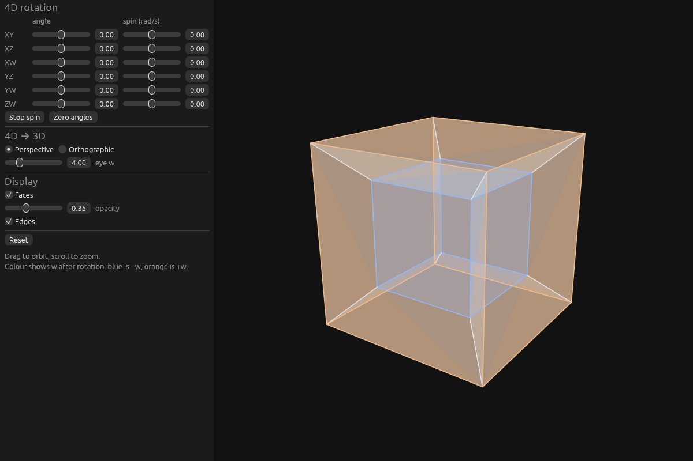
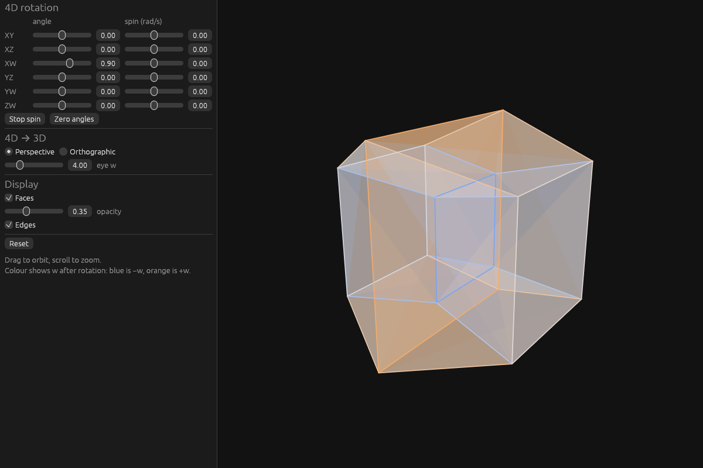
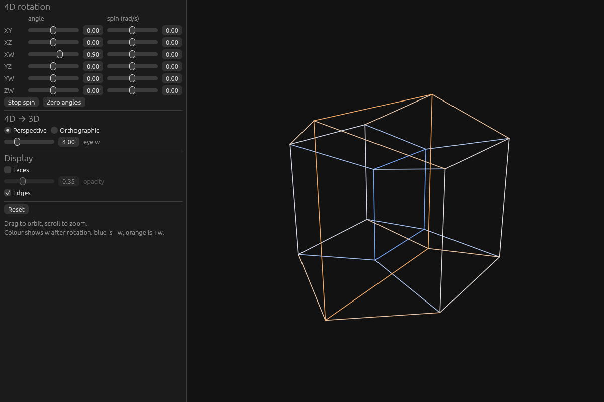
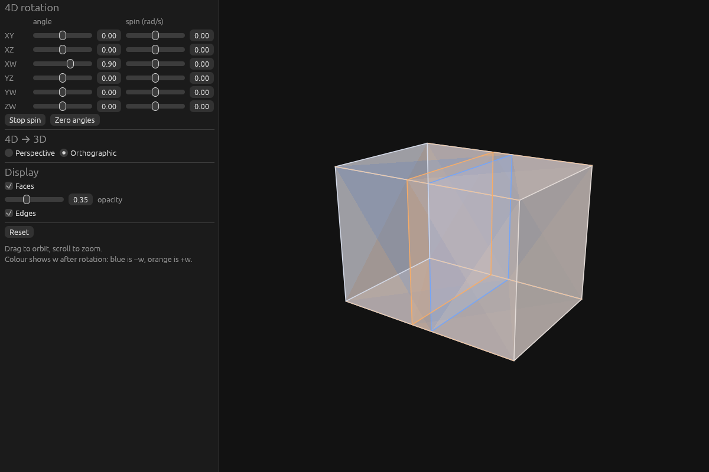

# four-dimensional-visualizer

Visualizes a four-dimensional object through a 3D "screen" that you navigate with an ordinary 2D projection, because we are mortals.

The shape (currently a tesseract) is rotated in 4D, projected into 3D, and the 3D result is drawn by an orbit camera. Faces are translucent and coloured by their w coordinate after rotation: blue is −w, orange is +w.



| XW rotation | Edges only | Orthographic |
| --- | --- | --- |
|  |  |  |

## Requirements

Every OS needs **Rust 1.95 or newer**, installed with [rustup](https://rustup.rs). If you already have Rust, run `rustup update`. You also need **Git** and a graphics driver with **OpenGL 2.0+**, which any normal desktop or laptop has.

The first build compiles about 400 crates and takes a few minutes. Later builds are quick.

### Windows

1. Install the **Visual Studio Build Tools** with the "Desktop development with C++" workload. The rustup installer offers to do this; say yes.
2. Install Rust with `rustup-init.exe` from <https://rustup.rs>, keeping the default (MSVC) toolchain.

Remote desktop sessions and some virtual machines have no OpenGL. If the window fails to open there, run it on the machine directly.

### macOS

1. Install the Xcode command-line tools: `xcode-select --install`
2. Install Rust: `curl --proto '=https' --tlsv1.2 -sSf https://sh.rustup.rs | sh`

### Linux

You need a C linker and Rust at build time. The window libraries (X11 or Wayland, xkbcommon and OpenGL) are loaded at run time, and a normal desktop install already has them.

Debian / Ubuntu:
```sh
sudo apt install build-essential curl git
# Only if the window fails to open (e.g. a minimal install):
sudo apt install libxkbcommon-x11-0 libx11-xcb1 libxcursor1 libxrandr2 libxi6 libgl1 libegl1
```

Fedora:
```sh
sudo dnf install gcc curl git
# Only if the window fails to open:
sudo dnf install libxkbcommon-x11 libXcursor libXrandr libXi mesa-libGL mesa-libEGL
```

Arch:
```sh
sudo pacman -S base-devel curl git
# Only if the window fails to open:
sudo pacman -S libxkbcommon-x11 libxcursor libxrandr libxi mesa
```

Then install Rust: `curl --proto '=https' --tlsv1.2 -sSf https://sh.rustup.rs | sh`

**WSL2:** this works on Windows 11 (WSLg shows the window). Install the Debian/Ubuntu packages above, including the optional line. Windows 10 needs a separate X server.

## Build and run

```sh
git clone https://github.com/Zak3211/four-dimensional-visualizer
cd four-dimensional-visualizer
cargo run --release -p viewer
```

## Controls

- **4D rotation:** six angle sliders, one per plane (XY, XZ, XW, YZ, YW, ZW), each with a spin rate. *Stop spin* freezes the motion and *Zero angles* returns to the start orientation. The planes involving w are the interesting ones.
- **4D → 3D:** perspective (with the 4D eye's w position) or orthographic, which just drops w.
- **Display:** faces on/off, face opacity, and edges on/off.
- **Camera:** drag to orbit and scroll to zoom.
- **Reset:** puts everything back to the start-up view.

Optional start-up flags (after `--` with `cargo run`):

```sh
cargo run --release -p viewer -- --angles 0,0,0.9,0,0,0 --spin 0,0,0,0,0,0 --ortho --no-faces
```

The flags are `--angles a,b,c,d,e,f` (radians, in XY XZ XW YZ YW ZW order), `--spin a,b,c,d,e,f`, `--eye W`, `--ortho`, `--no-faces` and `--no-edges`.

## Development

```sh
cargo test --workspace
cargo fmt --all --check
cargo clippy --workspace --all-targets -- -D warnings
```

`crates/geom4` is the maths, with no dependencies. `crates/viewer` is the eframe app. See `CLAUDE.md` for the architecture and roadmap.
